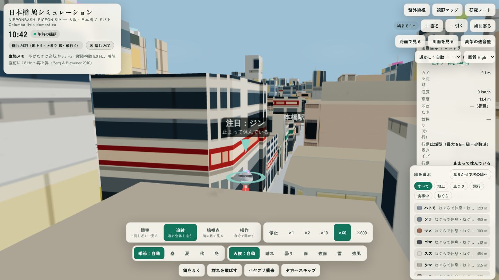
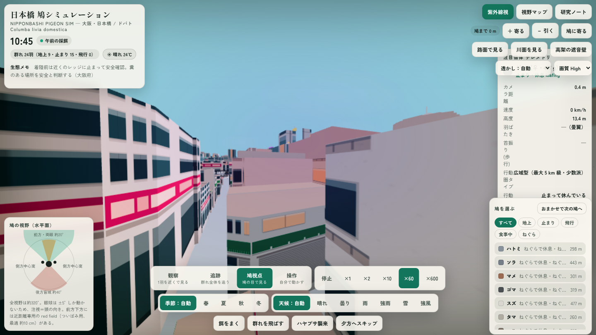
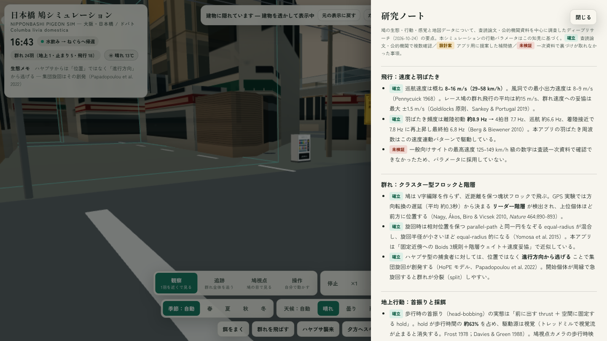

# 日本橋 鳩シミュレーション / Nihonbashi Pigeon Simulation

大阪・日本橋（にっぽんばし）の実データ 3D マップの上で、24 羽のドバトが自律的に暮らすシミュレーションです。ハトの生態・行動に関する調査（論文を含む）をもとに行動パラメータを設計し、「眺めるだけでも楽しく、いずれは操作もできる」ことを目指して開発しました。

A 3D simulation of 24 rock pigeons living autonomously on a real-data map of Nipponbashi, Osaka, Japan. Behaviour parameters are grounded in published research on pigeon ecology. Open `index.html` and watch — or take control and lead the flock yourself.

## デモ

- 公開ページ（Muse 上でホストされている現行ビルド）: https://muse.ai/s/space-xdc6mv97xuxd4xr/nr2bYkPKLhiTqrmyrvWZurI5aNg5RuHng7chD1OaA4k
- このリポジトリの `index.html` は単一ファイル版です。ローカルでは任意の静的サーバーで配信してください（例: `python3 -m http.server` でこのフォルダを開き、`http://localhost:8000/` へアクセス）。

## スクリーンショット

クラウド環境のブラウザ（GPU なし・ソフトウェア WebGL、1440x810）で撮影したものです。実機の GPU では描画の見え方や速度が異なる場合があります。

## 特徴

- **実データの街**: OpenStreetMap の実データから構築した日本橋エリア（建物 9,079 棟、堺筋・千日前通・御堂筋などの道路名、阪神高速の高架、道頓堀川・東横堀川）。建物は用途別にファサードを描き分け（オフィス／商業／住宅／低層店舗）、屋上設備、街路樹、電柱・架線、自販機、マンホール、横断歩道、袖看板、半透明の遮音壁まで配置。
- **調査に基づくハトの行動**: 巡航速度と連動する羽ばたき周波数、首振り（hold / thrust）、二段着陸、採餌の producer / scrounger、吸水飲水、求愛の bow-coo、1 日のスケジュール（夕方のねぐら帰還）などを調査レポートの数値で実装。飛行は「短距離の移動と逃避」が中心で、地上の採餌と止まり木の休息が主役になるよう行動配分を調整しています。
- **4 つのモード**: 観察（自由カメラ）、追跡（個体を追う）、鳩視点（頭部カメラ＋視覚マップ、紫外帯の疑似カラー）、操作（群れのリーダーとして誘導）。
- **季節と天候**: 大阪の緯度経度で太陽位置を計算し、日の出・日没でハトのスケジュールと光を駆動。季節は実日付連動＋手動切替、街路樹の色替えや繁殖期・冬季の行動変化、天候（晴れ・曇り・雨・強雨・雪・強風）の自動遷移と、それに応じた避雨・水浴び・ドリフトなどの行動変化を実装。
- **イベント**: 餌まき、ハヤブサの襲撃（集団逃避モデル）、夕方へのスキップなど。
- **時間速度**: 停止・×1・×2・×10・×60・×600。路面視点・川面視点・高架の遮音壁へのビューポイントボタン付き。

## ドキュメント

- [コンセプトとモチベーション](docs/concept.md) — なぜ作ったか、何を大切にしたか
- [開発の経緯](docs/development-history.md) — 2026-10-24 の初版から OSS 公開までの記録
- [改善の記録](docs/improvement-log.md) — 改善項目ごとの内容と検証結果（未確認のまま閉じた項目も含む）
- [事前調査レポート](docs/research/report.md) — ハトの生態・視覚・行動と日本橋の 3D 地図データに関する調査（出典は [sources.md](docs/research/sources.md)）
- [変更履歴](CHANGELOG.md)

## データとライセンス

- 地図データ: © OpenStreetMap contributors（ODbL）。建物・道路・水系の形状は OpenStreetMap 由来です。
- 本リポジトリのコードとドキュメント: Apache License 2.0（[LICENSE](LICENSE)）。
- ハトの生態パラメータは公開研究に基づきます。各数値の出典は調査レポートに記載しています。

## 今後の発展

- PLATEAU LOD1 データへの差し替え（現行は OSM 採用。経緯は開発の経緯を参照）
- パフォーマンス改善（高解像度デスクトップでの描画負荷）
- 行動・外観のリアリティ向上（Issue・PR 歓迎）
